# claude-skills

Personal Claude Code plugin marketplace (`fausto-skills`). Each top-level folder is a plugin
(a bundle of skills). Skills are invoked as `<bundle>:<skill>`, e.g. `core:tdd`.

| Bundle | Skills | Enable |
|---|---|---|
| `core` | tdd, debug, review, git | user scope, always |
| `planning` | grill-me, to-ticket, to-prd, to-adr, to-tickets, linear | user scope, always |
| `web` | design-taste-frontend, product-ui, a11y, seo-aeo-best-practices, vercel-react-best-practices | per project |

## Install (once per machine)

```
/plugin marketplace add faustorenier/claude-skills
/plugin install core@fausto-skills
/plugin install planning@fausto-skills
```

GitHub is the only source. After a push, refresh the catalog and the bundles, then restart
Claude Code:

```
claude plugin marketplace update fausto-skills
claude plugin update core@fausto-skills
claude plugin update planning@fausto-skills
```

## Enable `web` in one project

1. From the project root: `claude plugin install web@fausto-skills --scope project`
   (`--scope local` to enable it only for yourself).
2. Add the marketplace source to `<project>/.claude/settings.json`. The install command does not
   write it, and without it nobody else can find `fausto-skills`:

   ```json
   {
     "extraKnownMarketplaces": {
       "fausto-skills": {
         "source": { "source": "github", "repo": "faustorenier/claude-skills" }
       }
     },
     "enabledPlugins": { "web@fausto-skills": true }
   }
   ```

3. Commit `.claude/settings.json`. Collaborators need read access to this private repo.

Update after a push: `claude plugin update web@fausto-skills --scope project`.

## Workflow

### Planning

An idea becomes one Linear issue or a PRD with vertical-slice issues. ADRs are recorded on the
way; nothing is written to the repo or Linear before you approve the draft. Rules:
`planning/skills/_shared/workflow.md`.

```mermaid
%%{init: {"look": "classic", "fontFamily": "ui-monospace, SFMono-Regular, Menlo, Consolas, monospace", "theme": "base", "themeVariables": {"background": "#1c1c1f", "primaryColor": "#232326", "primaryBorderColor": "#3a3a3f", "primaryTextColor": "#e6e6e6", "secondaryColor": "#232326", "tertiaryColor": "#1f1f23", "textColor": "#c8c8cc", "lineColor": "#6b6b70", "clusterBkg": "#1f1f23", "clusterBorder": "#34343a", "titleColor": "#9a9aa0", "edgeLabelBackground": "#18181b", "fontSize": "14px"}, "flowchart": {"curve": "basis", "rankSpacing": 35}}}%%
flowchart TB
  subgraph card[" "]
    direction TB
    grill["grill-me"] --> size{"Slices?"}
    size -- one --> ticket["to-ticket"]
    size -- "2+" --> prd["to-prd"]
    prd --> project["PRD + Linear project"]
    project --> tickets["to-tickets"]
    ticket --> issue["Linear issue(s)"]
    tickets --> issue
    issue --> tdd["core:tdd"]
  end
  classDef default rx:5,ry:5,stroke-width:1px
  style card fill:#18181b,stroke:#2a2a2e,rx:8,ry:8
```



### Implementation

`core:tdd` runs one red-green-refactor cycle per acceptance criterion, then `core:review` in a
clean context. After later changes, re-run `core:review` or `/code-review` by hand.

```mermaid
%%{init: {"look": "classic", "fontFamily": "ui-monospace, SFMono-Regular, Menlo, Consolas, monospace", "theme": "base", "themeVariables": {"background": "#1c1c1f", "primaryColor": "#232326", "primaryBorderColor": "#3a3a3f", "primaryTextColor": "#e6e6e6", "secondaryColor": "#232326", "tertiaryColor": "#1f1f23", "textColor": "#c8c8cc", "lineColor": "#6b6b70", "clusterBkg": "#1f1f23", "clusterBorder": "#34343a", "titleColor": "#9a9aa0", "edgeLabelBackground": "#18181b", "fontSize": "14px"}, "flowchart": {"curve": "basis", "rankSpacing": 35}}}%%
flowchart TB
  subgraph card[" "]
    direction TB
    issue["Linear issue"] --> blk{"Blockers done?"}
    blk -- No --> stop["Stop"]
    blk -- Yes --> branch["Branch · In Progress"]
    small["Small change"] -- plan mode --> branch
    branch --> red
    subgraph cycle["one cycle per criterion"]
      direction TB
      red["RED"] --> green["GREEN · commit"] --> refactor["REFACTOR"] --> more{"More?"}
      more -- Yes --> red
    end
    more -- No --> checks["Checks · core:review"]
    checks --> pr["In Review · PR"]
  end
  classDef default rx:5,ry:5,stroke-width:1px
  style card fill:#18181b,stroke:#2a2a2e,rx:8,ry:8
  style cycle rx:6,ry:6
```



### Bugs

`core:debug` finds the root cause before any fix, then hands a failing test to `core:tdd`.
Use `/planning:to-ticket` only if the bug must be tracked.

```mermaid
%%{init: {"look": "classic", "fontFamily": "ui-monospace, SFMono-Regular, Menlo, Consolas, monospace", "theme": "base", "themeVariables": {"background": "#1c1c1f", "primaryColor": "#232326", "primaryBorderColor": "#3a3a3f", "primaryTextColor": "#e6e6e6", "secondaryColor": "#232326", "tertiaryColor": "#1f1f23", "textColor": "#c8c8cc", "lineColor": "#6b6b70", "clusterBkg": "#1f1f23", "clusterBorder": "#34343a", "titleColor": "#9a9aa0", "edgeLabelBackground": "#18181b", "fontSize": "14px"}, "flowchart": {"curve": "basis", "rankSpacing": 35}}}%%
flowchart TB
  subgraph card[" "]
    direction TB
    repro["Reproduce"] --> hyp["Hypothesis"]
    hyp --> ok{"Confirmed?"}
    ok -- No --> fails{"3 failed fixes?"}
    fails -- No --> hyp
    fails -- Yes --> stop["Stop · discuss"]
    ok -- Yes --> test["Failing test"]
    test --> tdd["core:tdd"]
  end
  classDef default rx:5,ry:5,stroke-width:1px
  style card fill:#18181b,stroke:#2a2a2e,rx:8,ry:8
```



### Which `web` skills

| Work | Skills |
|---|---|
| Visual (layout, animation, 3D) | no TDD; describe what to check visually |
| Landing, portfolio, marketing site | `design-taste-frontend` + `seo-aeo-best-practices` + `a11y` |
| Dashboard, admin, forms, tables | `product-ui` + `a11y`; logic through `core:tdd` |

In projects with `components.json`, add the official shadcn skill: `npx skills add shadcn/ui`
(commit `.claude/skills/`).

## Adding or editing a skill

- Work in a clone of this repo, never in `~/.claude/plugins/marketplaces/` (overwritten on update).
- Create `<bundle>/skills/<skill-name>/SKILL.md` with `name` and `description` frontmatter. Add
  `disable-model-invocation: true` for skills that run only via `/<bundle>:<name>`: their
  description then costs no context.
- Push, then update as in Install. Never add `version` to `plugin.json`: the commit SHA is the
  version, so every push is picked up.
