# unslop

Personal Claude Code plugin marketplace (`unslop`). Each top-level folder is a plugin
(a bundle of skills). Skills are invoked as `<bundle>:<skill>`, e.g. `core:tdd`.

| Bundle | Skills | Enable |
|---|---|---|
| `rig` | init, dev-loop, auto-dev, herdr | user scope, always |
| `core` | tdd, debug, review, git | user scope, always |
| `planning` | grill-me, to-ticket, to-prd, to-adr, to-tickets, linear | user scope, always |
| `web` | design-taste-frontend, product-ui, a11y, seo-aeo-best-practices, vercel-react-best-practices | per project |

`planning` decides what to build, `core` holds the rules for how to build it, `rig` is the
multi-agent setup that has a developer and a reviewer agent apply those rules. `rig` works only
in projects prepared with `/rig:init`, and needs [Herdr](https://herdr.dev).

## Install (once per machine)

```
/plugin marketplace add faustorenier/unslop
/plugin install core@unslop
/plugin install planning@unslop
/plugin install rig@unslop
```

GitHub is the only source. After a push, refresh the catalog and the bundles, then restart
Claude Code:

```
claude plugin marketplace update unslop
claude plugin update core@unslop
claude plugin update planning@unslop
claude plugin update rig@unslop
```

Or turn on auto-update once: `/plugin` → Marketplaces → `unslop` → auto-update. Claude Code then
refreshes the catalog and the installed bundles in the background of each interactive session;
run `/reload-plugins` when it says a plugin was updated. Third-party marketplaces have it off by
default. Projects set up with `/rig:init` turn it on through their `.claude/settings.json`.

## Workflow

### Planning

An idea becomes one Linear issue or a PRD with vertical-slice issues. ADRs are recorded on the
way; nothing is written to the repo or Linear before you approve the draft. Rules:
`planning/skills/_shared/workflow.md`.

```mermaid
%%{init: {"look": "classic", "fontFamily": "ui-monospace, SFMono-Regular, Menlo, Consolas, monospace", "theme": "base", "themeVariables": {"background": "#1c1c1f", "primaryColor": "#232326", "primaryBorderColor": "#3a3a3f", "primaryTextColor": "#e6e6e6", "secondaryColor": "#232326", "tertiaryColor": "#1f1f23", "textColor": "#c8c8cc", "lineColor": "#6b6b70", "clusterBkg": "#1f1f23", "clusterBorder": "#34343a", "titleColor": "#9a9aa0", "edgeLabelBackground": "#18181b", "fontSize": "14px"}, "flowchart": {"curve": "basis", "rankSpacing": 35}}}%%
flowchart TB
  subgraph card[" "]
    direction TB
    grill["grill-me"] --> size{"Slices?"}
    size -- one --> ticket["to-ticket"]
    size -- "2+" --> prd["to-prd"]
    prd --> project["PRD + Linear project"]
    project --> tickets["to-tickets"]
    ticket --> issue["Linear issue(s)"]
    tickets --> issue
    issue --> tdd["core:tdd"]
  end
  classDef default rx:5,ry:5,stroke-width:1px
  style card fill:#18181b,stroke:#2a2a2e,rx:8,ry:8
```



### Implementation

`core:tdd` runs one red-green-refactor cycle per acceptance criterion, then `core:review` in a
clean context. After later changes, re-run `core:review` or `/code-review` by hand.

```mermaid
%%{init: {"look": "classic", "fontFamily": "ui-monospace, SFMono-Regular, Menlo, Consolas, monospace", "theme": "base", "themeVariables": {"background": "#1c1c1f", "primaryColor": "#232326", "primaryBorderColor": "#3a3a3f", "primaryTextColor": "#e6e6e6", "secondaryColor": "#232326", "tertiaryColor": "#1f1f23", "textColor": "#c8c8cc", "lineColor": "#6b6b70", "clusterBkg": "#1f1f23", "clusterBorder": "#34343a", "titleColor": "#9a9aa0", "edgeLabelBackground": "#18181b", "fontSize": "14px"}, "flowchart": {"curve": "basis", "rankSpacing": 35}}}%%
flowchart TB
  subgraph card[" "]
    direction TB
    issue["Linear issue"] --> blk{"Blockers done?"}
    blk -- No --> stop["Stop"]
    blk -- Yes --> branch["Branch · In Progress"]
    small["Small change"] -- plan mode --> branch
    branch --> red
    subgraph cycle["one cycle per criterion"]
      direction TB
      red["RED"] --> green["GREEN · commit"] --> refactor["REFACTOR"] --> more{"More?"}
      more -- Yes --> red
    end
    more -- No --> checks["Checks · core:review"]
    checks --> pr["In Review · PR"]
  end
  classDef default rx:5,ry:5,stroke-width:1px
  style card fill:#18181b,stroke:#2a2a2e,rx:8,ry:8
  style cycle rx:6,ry:6
```



### Bugs

`core:debug` finds the root cause before any fix, then hands a failing test to `core:tdd`.
Use `/planning:to-ticket` only if the bug must be tracked.

```mermaid
%%{init: {"look": "classic", "fontFamily": "ui-monospace, SFMono-Regular, Menlo, Consolas, monospace", "theme": "base", "themeVariables": {"background": "#1c1c1f", "primaryColor": "#232326", "primaryBorderColor": "#3a3a3f", "primaryTextColor": "#e6e6e6", "secondaryColor": "#232326", "tertiaryColor": "#1f1f23", "textColor": "#c8c8cc", "lineColor": "#6b6b70", "clusterBkg": "#1f1f23", "clusterBorder": "#34343a", "titleColor": "#9a9aa0", "edgeLabelBackground": "#18181b", "fontSize": "14px"}, "flowchart": {"curve": "basis", "rankSpacing": 35}}}%%
flowchart TB
  subgraph card[" "]
    direction TB
    repro["Reproduce"] --> hyp["Hypothesis"]
    hyp --> ok{"Confirmed?"}
    ok -- No --> fails{"3 failed fixes?"}
    fails -- No --> hyp
    fails -- Yes --> stop["Stop · discuss"]
    ok -- Yes --> test["Failing test"]
    test --> tdd["core:tdd"]
  end
  classDef default rx:5,ry:5,stroke-width:1px
  style card fill:#18181b,stroke:#2a2a2e,rx:8,ry:8
```



### Multi-agent execution (`rig`)

`/rig:init` prepares a project once: git and GitHub repo, a Linear team in `.linear.toml`,
`## Workflow` and `## Verification` in CLAUDE.md, `AGENTS.md` and `loop-models.json`. It also links
the `auto-dev` command into `~/.local/bin`.

In a Herdr pane, `/rig:dev-loop <ISSUE>` runs one issue: the orchestrator opens a developer and a
reviewer agent (tool, model and effort from `loop-models.json`, or a personal gitignored
`loop-models.local.json`), drives TDD and up to three review
rounds, pushes the branch and opens the PR. `auto-dev "<project>"` repeats this for every
unblocked issue of a Linear project, merging each into `auto/<project-slug>`, and opens one PR into
`main` at the end. Merging into `main` always stays with you.

```mermaid
%%{init: {"look": "classic", "fontFamily": "ui-monospace, SFMono-Regular, Menlo, Consolas, monospace", "theme": "base", "themeVariables": {"background": "#1c1c1f", "primaryColor": "#232326", "primaryBorderColor": "#3a3a3f", "primaryTextColor": "#e6e6e6", "secondaryColor": "#232326", "tertiaryColor": "#1f1f23", "textColor": "#c8c8cc", "lineColor": "#6b6b70", "clusterBkg": "#1f1f23", "clusterBorder": "#34343a", "titleColor": "#9a9aa0", "edgeLabelBackground": "#18181b", "fontSize": "14px"}, "flowchart": {"curve": "basis", "rankSpacing": 35}}}%%
flowchart TB
  subgraph card[" "]
    direction TB
    init["rig:init"] --> issues["Linear issues"]
    issues --> one{"One issue?"}
    one -- Yes --> devloop["rig:dev-loop"]
    one -- "Whole project" --> autodev["auto-dev"]
    autodev -- "each issue" --> devloop
    devloop --> agents["developer ⇄ reviewer · Herdr"]
    agents --> pr["PR · you merge"]
  end
  classDef default rx:5,ry:5,stroke-width:1px
  style card fill:#18181b,stroke:#2a2a2e,rx:8,ry:8
```



## Collaboration

This repository is public: anyone can install the plugins, and only the owner can change them.
Colleagues need no access to it. Suggestions come as issues or pull requests from forks, merged
only by the owner.

A colleague needs: collaborator access to the project repository, membership of the Linear
workspace and of the project's team (named in its `.linear.toml`).

### Join a project already set up with `/rig:init`

1. Install `claude`, `gh` (`gh auth login`), `linear` (`linear auth login` with their own API key),
   `herdr` (`herdr integration install claude`), `jq`, Node, and `opencode` if `loop-models.json`
   uses it.
2. Clone the project and open `claude` in it. `.claude/settings.json` makes Claude Code offer the
   unslop plugins: accept.
3. Run `/rig:init`. It finds the repo, team and files already in place and leaves them alone; it
   only sets up this machine (the `auto-dev` link, the Herdr checks) and runs the preflight, which
   lists anything still missing.

### Working together

- **One `auto-dev` per Linear project at a time.** Two loops on the same project pick the same
  issue. Split the work by project, or use `/rig:dev-loop` on different issues.
- Everyone merges PRs into `main` themselves; the rig never does.
- `loop-models.json` is the project's shared default. Anyone can override a role for themselves
  in `loop-models.local.json`, gitignored, with the same shape, to match their own subscriptions.

## Adding or editing a skill

- Work in a clone of this repo, never in `~/.claude/plugins/marketplaces/` (overwritten on update).
- Create `<bundle>/skills/<skill-name>/SKILL.md` with `name` and `description` frontmatter. Add
  `disable-model-invocation: true` for skills that run only via `/<bundle>:<name>`: their
  description then costs no context.
- Push, then update as in Install. Never add `version` to `plugin.json`: the commit SHA is the
  version, so every push is picked up.

## `web`

### Enable it in one project

1. From the project root: `claude plugin install web@unslop --scope project`
   (`--scope local` to enable it only for yourself).
2. Add the marketplace source to `<project>/.claude/settings.json`. The install command does not
   write it, and without it nobody else can find `unslop`:

   ```json
   {
     "extraKnownMarketplaces": {
       "unslop": {
         "source": { "source": "github", "repo": "faustorenier/unslop" }
       }
     },
     "enabledPlugins": { "web@unslop": true }
   }
   ```

3. Commit `.claude/settings.json`.

Update after a push: `claude plugin update web@unslop --scope project`.

### Which skills

| Work | Skills |
|---|---|
| Visual (layout, animation, 3D) | no TDD; describe what to check visually |
| Landing, portfolio, marketing site | `design-taste-frontend` + `seo-aeo-best-practices` + `a11y` |
| Dashboard, admin, forms, tables | `product-ui` + `a11y`; logic through `core:tdd` |

In projects with `components.json`, add the official shadcn skill: `npx skills add shadcn/ui`
(commit `.claude/skills/`).
